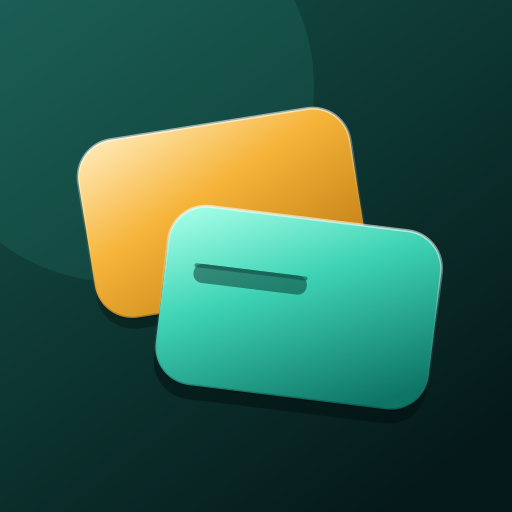
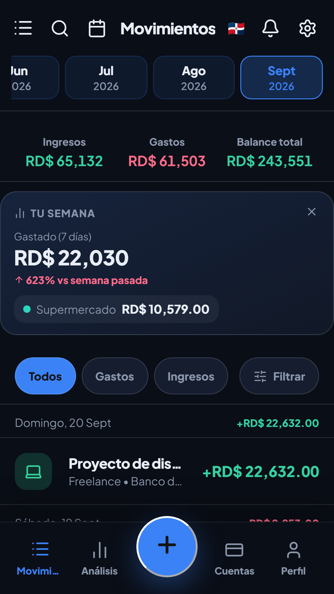
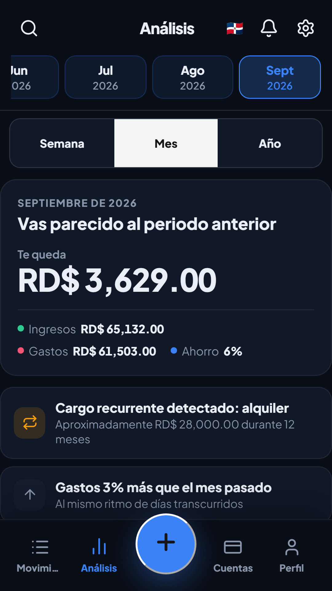
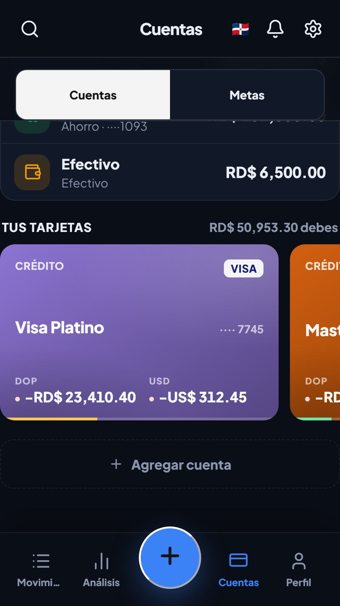
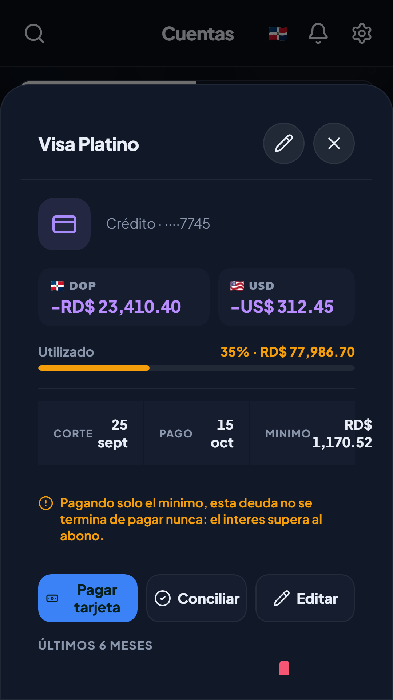
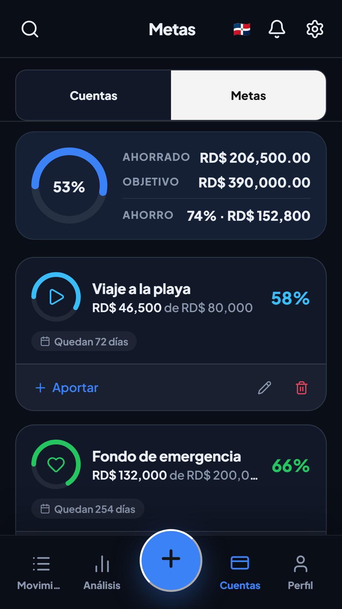

<div align="center">



# Cuadre

**Tus finanzas personales, hechas para República Dominicana.**
Registra, presupuesta y proyecta tu dinero sin hojas de Excel, sin cuentas y sin servidor.

[](https://github.com/XsharklinX/Cuadre/releases)


[**Descargar**](#instalación) · [Funcionalidades](#qué-puedes-hacer-con-cuadre) · [Capturas](#así-se-ve) · [Privacidad](#privacidad) · [Desarrollo](#empezar-a-desarrollar) · [Roadmap](ROADMAP.md)

<a href="https://play.google.com/store/apps/details?id=com.sharky.miapp">
  
</a>

</div>

---

## Así se ve

<table>
<tr>
<td></td>
<td></td>
<td></td>
<td></td>
<td></td>
</tr>
<tr>
<td align="center"><sub><b>Movimientos</b><br/>Tu mes de un vistazo</sub></td>
<td align="center"><sub><b>Análisis</b><br/>Qué cambió y qué hacer</sub></td>
<td align="center"><sub><b>Cuentas</b><br/>Efectivo, bancos y tarjetas</sub></td>
<td align="center"><sub><b>Tarjetas</b><br/>Deuda, límite y pago</sub></td>
<td align="center"><sub><b>Metas</b><br/>Ahorro con aportes</sub></td>
</tr>
</table>

## Por qué existe

Casi todas las apps de finanzas personales están pensadas para otro país: no reconocen los bancos locales, muestran todo en dólares y nadie les enseña a leer un aviso del Popular o de Banreservas. Cuadre nació de llevar las cuentas en una hoja de cálculo que se desactualizaba cada dos semanas.

Es una app **mobile-first y local-first**: pensada primero para tu teléfono, funciona completa sin internet y tus datos viven en tu dispositivo. No hay cuenta que crear ni servidor al que subir nada.

| | |
| --- | --- |
| **Rápida** | Anotas un gasto en segundos, con sugerencias que aprenden de tus hábitos. |
| **Dominicana** | Pesos como moneda base, bancos locales y importación de sus archivos. |
| **Privada** | Sin cuentas, sin nube propia y sin telemetría de terceros. |
| **Confiable** | Cada saldo se puede explicar y reconstruir desde tus movimientos. |

## Qué puedes hacer con Cuadre

### Anotar y entender tu dinero

- **Ingresos, gastos y transferencias** con categoría, cuenta, notas y fotos del recibo.
- **Gastos divididos**: una compra del súper puede repartirse entre varias categorías.
- **Categorización que aprende**: si siempre pones «Uber» en Transporte, la próxima vez te lo sugiere.
- **Rápidos**: tus gastos más repetidos a un toque, con opción de fijar u ocultar.
- **Búsqueda global** de movimientos, cuentas y metas.
- **Recibos con OCR**: una foto del recibo y la app extrae el monto (ML Kit en Android, Tesseract.js en el navegador).

### Cuentas y tarjetas

- Efectivo, débito, ahorro y **tarjetas de crédito**, cada una con su color, su política de sobregiro y, si hace falta, **su propia moneda**.
- **9 monedas** (DOP, USD, EUR, MXN, GBP, COP, ARS, BRL, CAD) con tasas de cambio actualizadas cuando hay conexión y calculadora de divisas integrada.
- Pasivos y patrimonio que cuentan la **deuda real de tus tarjetas**, con un rescate guiado si alguna se capturó al revés.

### Presupuestos y metas

- **Presupuesto mensual por categoría** con *rollover*: el sobrante (o el exceso) pasa al mes siguiente.
- **Alertas** al 80 % y al 100 %, configurables por categoría.
- **Metas de ahorro** con fecha objetivo y **aportes automáticos** desde la cuenta que elijas.

### Ver lo que viene

- **Suscripciones y pagos fijos** con catálogo de servicios populares, pausa y salto de ciclos.
- **Flujo de caja proyectado**: un calendario con tu saldo día por día que avisa si vas a quedar en negativo *antes* de que pase.
- **Simulador de deudas** con las estrategias *avalanche* y *snowball*: cuánto interés y cuántos meses te ahorras con cada una.

### Inteligencia con acciones

Cuadre detecta anomalías de gasto, tendencias y cargos recurrentes que nunca marcaste como suscripción. Cada hallazgo trae un botón de acción directa (ajustar el presupuesto, volverlo recurrente) en lugar de un reporte que se archiva y se olvida.

### Importar y exportar

- **CSV de Banco Popular, BHD, Banreservas y Scotiabank** con detección de columnas, vista previa y deduplicación.
- **Detección de notificaciones bancarias** en Android: los avisos de tu banco se convierten en movimientos para confirmar.
- **Reportes**: PDF mensual, Excel por mes/categoría/cuenta, CSV y capturas PNG de las gráficas.
- **Traspaso entre teléfonos** por código QR.

### Respaldo y seguridad

- Backup manual en JSON con **cifrado por contraseña** opcional, backup automático semanal y puntos de recuperación locales.
- **PIN, patrón o biometría** para abrir la app, guardados en el Keystore de Android y nunca en texto plano. Se sugieren después de tus primeros movimientos, no antes.
- Revisión de **salud de los datos** para encontrar inconsistencias antes de que importen.

### Detalles que se notan

- Widget de balance y accesos directos desde el ícono para anotar sin abrir la app.
- Recordatorios y avisos locales de presupuesto y pagos próximos.
- **7 temas**: sistema, oscuro, claro, AMOLED, océano, atardecer y bosque.
- Español e inglés completos, con detección del idioma del teléfono.

## Instalación

| Plataforma | Cómo se instala |
| --- | --- |
| **Android** | [Google Play](https://play.google.com/store/apps/details?id=com.sharky.miapp) o el APK de [Releases](https://github.com/XsharklinX/Cuadre/releases) |
| **Web (PWA)** | Desde el navegador, con «Agregar a pantalla de inicio» |
| **Windows** | Instalador `.exe` o versión portable desde [Releases](https://github.com/XsharklinX/Cuadre/releases) |

Es el mismo código en las tres plataformas. Lo que depende del hardware del teléfono (OCR nativo, notificaciones bancarias, widget, biometría) solo existe en Android; en la PWA y en Windows tienes el resto de la app.

## Privacidad

- **Tus datos se quedan en tu dispositivo.** No hay cuentas ni sincronización en la nube; no hay nada que filtrar ni a quién pedírselo.
- El PIN y el patrón se cifran con el Keystore de Android (o el llavero del sistema en escritorio).
- No hay telemetría de terceros. Cualquier diagnóstico es local y opcional.
- Las tasas de cambio son lo único que consulta internet, y no envían datos tuyos.

Más detalle en la [política de privacidad](docs/privacy.html).

## Stack técnico

| Capa | Tecnología |
| --- | --- |
| Interfaz | React 18 + TypeScript estricto |
| Build | Vite 6 + vite-plugin-pwa |
| Estado | Zustand 5 |
| App nativa | Tauri 2 (Rust) para Android y Windows, con plugins propios en Kotlin |
| Gráficas | Recharts |
| Exportación | jsPDF, ExcelJS, html2canvas |
| OCR | ML Kit (Android) / Tesseract.js (web) |
| Pruebas | Vitest (unitarias) + Playwright (extremo a extremo) |

## Estructura del proyecto

```text
src/
  mobile/        UI mobile-first: pantallas, hojas y ajustes
  store/         Estado con Zustand (finanzas, ajustes, deudas, rápidos)
  data/          Cálculos, importadores, backups, flujo de caja, inteligencia
  hooks/         Automatizaciones (recurrencias, backups, avisos, detección)
  lib/           Integraciones (OCR, biometría, cifrado, notificaciones)
  i18n/          Diccionarios ES/EN
  styles/        CSS por sección

plugins/         Plugins nativos de Android (notificaciones, OCR, widget, llavero…)
src-tauri/       Backend Rust y configuración de Tauri
e2e/             Pruebas de extremo a extremo con Playwright
docs/            Landing pública, políticas y guías de build/release
store-assets/    Capturas y material de las tiendas
```

## Empezar a desarrollar

Necesitas Node.js 20+ y npm. Para compilar la app nativa, además Rust estable y las dependencias de Tauri de tu sistema.

```bash
npm install
npm run dev            # web en localhost:3000
npm run tauri:dev      # versión de escritorio
```

### Validar cambios

```bash
npm run verify         # lint + typecheck + tests + e2e
```

O por separado: `npm run lint`, `npm run typecheck`, `npm run test`, `npm run test:e2e` y `cargo check --manifest-path src-tauri/Cargo.toml`.

### Compilar

```bash
npm run package:android -- -Debug -Target aarch64   # APK de depuración
npm run package:windows                              # instalador y portable
```

Los scripts de empaquetado usan PowerShell. Guías: [docs/ANDROID.md](docs/ANDROID.md) y [docs/RELEASE.md](docs/RELEASE.md). La carpeta `release/` no se versiona; los binarios se publican en [Releases](https://github.com/XsharklinX/Cuadre/releases).

## Hacia dónde va

El núcleo está completo y en uso. Lo siguiente está en el [ROADMAP](ROADMAP.md), con **Cuadre Compartido** como apuesta grande: un libro del hogar, aparte del personal, que dos personas pueden llevar juntas sin que nadie vea los gastos privados del otro.

## Contribuir

1. Revisa el [roadmap](ROADMAP.md): puede que lo que propones ya esté planeado o descartado por una razón.
2. Para cambios grandes, abre primero un issue.
3. Las pantallas van como componentes TypeScript en `src/mobile/`, sin estado global mutable.
4. Si tocas importadores, exportadores o migraciones de datos, agrega pruebas.
5. Corre `npm run verify` antes de abrir el PR.

## Licencia

El repositorio todavía no tiene una licencia pública definida. Si quieres reutilizar código, abre un issue antes.
